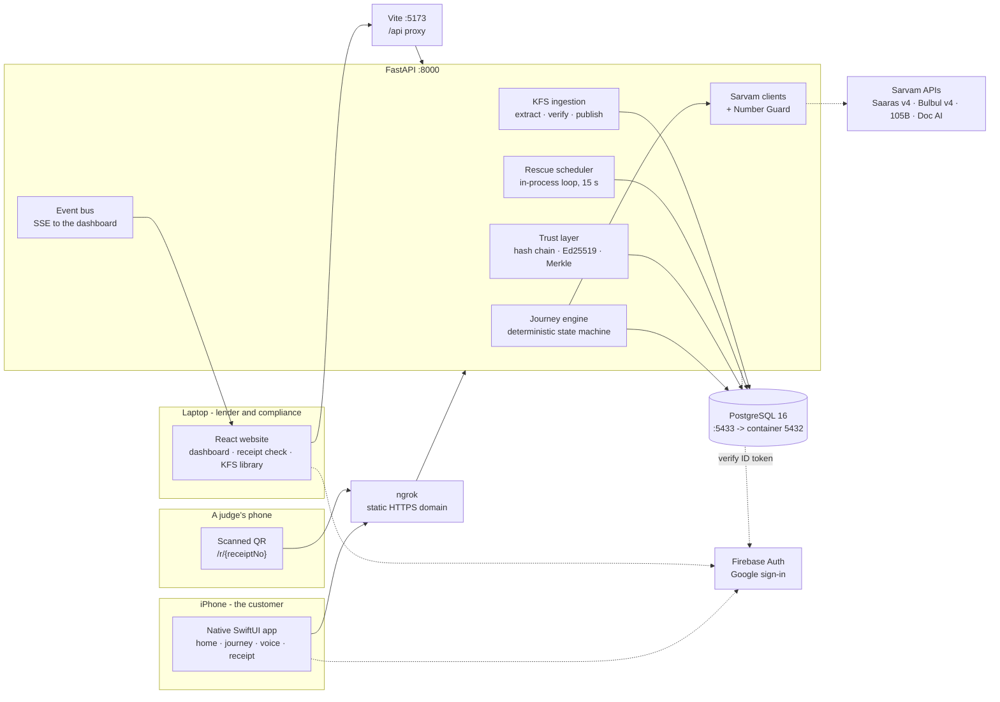
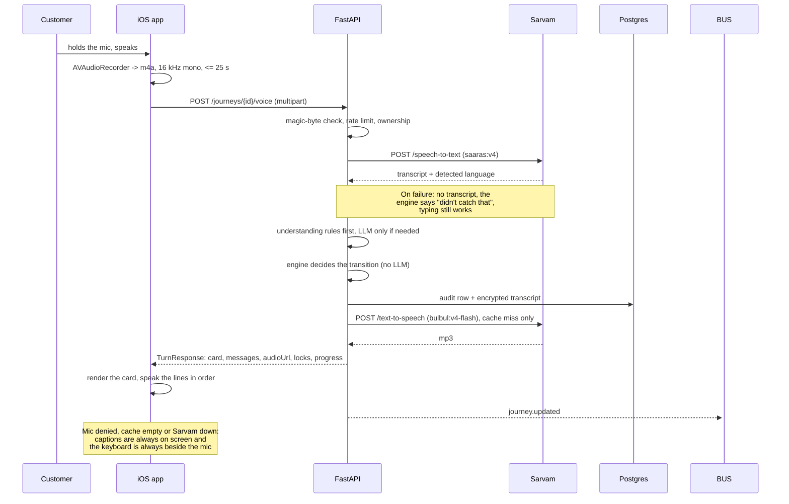
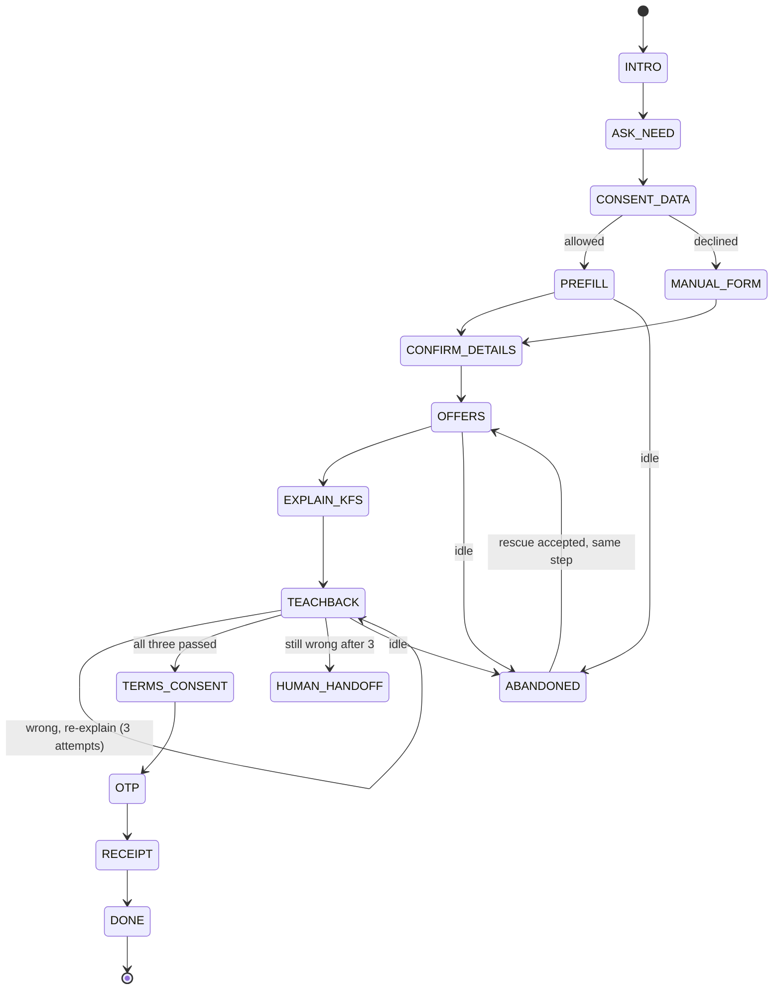
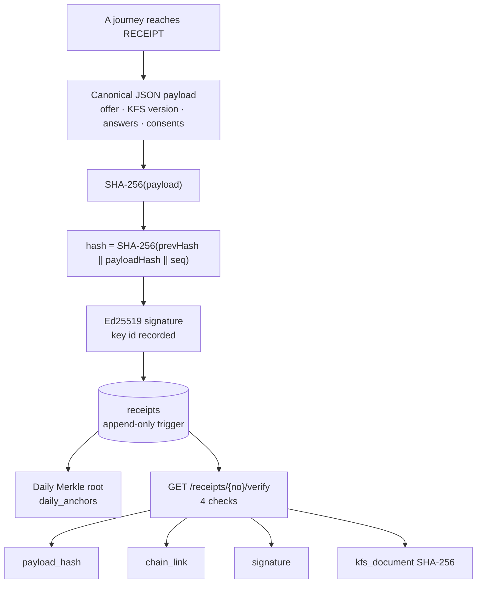
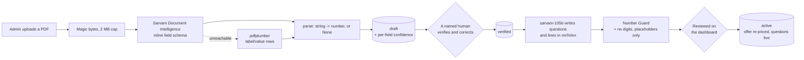
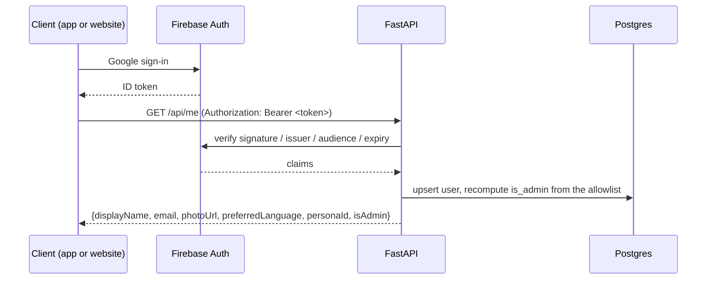

# Architecture

Three clients, one backend, one Postgres. Everything that decides anything lives
in the backend; the clients render what they are given (plan rule 10).

## System

**The Sarvam key exists in exactly one place: the backend.** No client has it,
no client calls Sarvam, and nothing a client sends can choose a model.

## A voice turn, end to end

The product's main interaction, with its latency budget (§10.4) and its failure
behaviour. Every arrow that leaves the backend can fail, and none of them can
stop the journey.

## The journey state machine

Code decides every transition. The LLM understands and phrases; it never moves
the journey (§9).

`TERMS_CONSENT` is unreachable until teach-back passes, and the lock is
re-checked in the engine when the tap arrives - not only rendered as a disabled
button.

## The trust layer

A PL/pgSQL `forbid_update_delete()` trigger runs BEFORE UPDATE OR DELETE on
`receipts`, `consents`, `audit_log` and `teachback_attempts`. Evidence the
application itself can rewrite is not evidence.

## KFS ingestion (phase 11)

Nothing reaches a customer from an unverified document, and no single action
publishes model-written text.

## Why the Vite proxy

The browser only ever talks to `:5173`. Vite forwards `/api` to FastAPI, so:

- there is no CORS in development,
- the demo needs **one** HTTPS tunnel, not two,
- the frontend never hard-codes a backend host.

The iPhone does not use the proxy: it talks to the tunnel directly, which is
why the app is not subject to CORS at all and why `CORS_ORIGINS` is an
allowlist for the website only.

## Layer rules (from the build plan)

| Rule | Where it is enforced |
|---|---|
| Code decides transitions, the LLM only phrases | `app/journey/engine.py` |
| The AI never invents a number | `app/ai/number_guard.py`, and `app/kfs/questions.py` rejects any digit |
| Only the backend creates receipts | `app/trust/issue.py` + DB triggers |
| Receipts/consents/audit/attempts are append-only | `forbid_update_delete()` triggers |
| Every voice action has a tap/type alternative | `TurnResponse.quickReplies` + the keyboard toggle beside the mic |
| Ownership returns 404, never 403 | `_owned()` in `api/journeys.py`, `_owned_task()` in `api/rescue.py` |
| No PII in logs | `app/logging.py` root-logger filter |
| Admin access is allowlist-only, never client-set | `auth/users.py` + `deps.current_admin` |
| A real token always outranks the demo header | `deps.current_user`, `lib/api.ts`, `APIClient.makeRequest` |
| Demo auth is impossible in an iOS Release build | `#if DEBUG` around `DemoAuth`; verified absent from the Release binary |
| Nothing is published without human verification | `app/kfs/ingest.py` |
| No KFS document reaches a customer unverified | `kfs_documents.status` + `activate()` |
| Never deploy publicly; the concept label is always visible | `ConceptRibbon` above every screen |

## Background work

One in-process `asyncio` task, started from the FastAPI lifespan: the rescue
scheduler, ticking every 15 seconds. No broker, no worker, nothing to debug on
stage - and it dies with the backend rather than outliving it. At scale this
becomes Celery and Redis, which is recorded in `docs/SECURITY.md`.

Its database work runs in a thread (`asyncio.to_thread`) because SQLAlchemy is
synchronous here, which is also why it hands its SSE events back to the event
loop to publish rather than touching the bus from the worker (D-045).

## Ports

| Port | Service |
|---|---|
| 5173 | Vite dev server (proxies `/api`) |
| 8000 | FastAPI |
| 5433 | Postgres on the host (5432 inside the container - see DECISIONS D-004) |
| 8080 | Adminer |

## Sign-in flow

The dev fallback replaces the first three steps with `X-Demo-User` plus
`X-Demo-Key`, which the backend honours only when `DEMO_AUTH=true`, `APP_ENV=dev`
and the key matches in constant time. A real bearer token always wins, on both
sides. In an iOS Release build the demo path does not exist in the binary.
