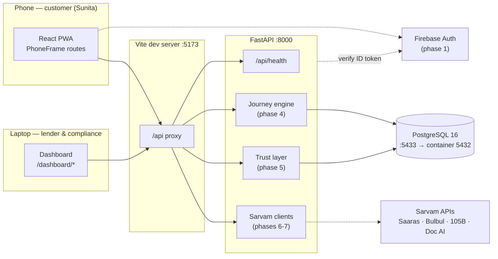
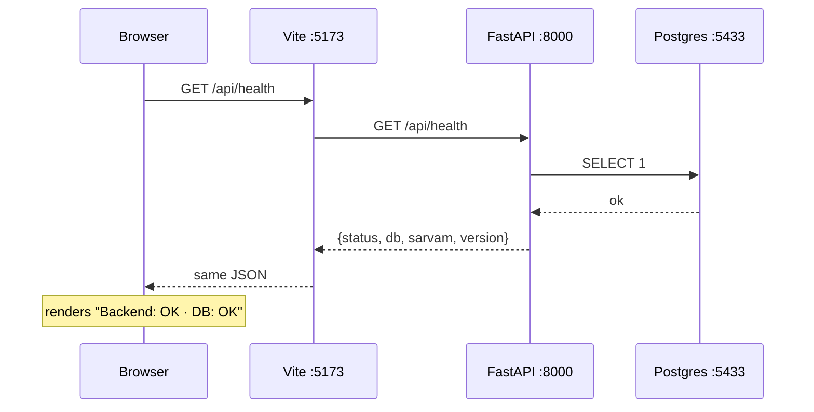

# Architecture

> Phase 0 shows the shell. Boxes marked _(phase N)_ are not built yet; this file
> is updated as each phase lands.

## System

## Why the Vite proxy

The browser only ever talks to `:5173`. Vite forwards `/api` to FastAPI, so:

- there is no CORS in development,
- phase 12 needs **one** HTTPS tunnel, not two,
- the frontend never hard-codes a backend host.

## Request path today (phase 0)

## Layer rules (from the build plan)

| Rule | Where it is enforced |
|---|---|
| Code decides transitions, the LLM only phrases | `app/journey/engine.py` _(phase 4)_ |
| The AI never invents a number | `app/ai/number_guard.py` _(phase 7)_ |
| Only the backend creates receipts | `app/trust/ledger.py` + DB triggers _(phase 5)_ |
| Receipts/consents/audit/attempts are append-only | `forbid_update_delete()` triggers _(phase 2)_ |
| Every voice action has a tap/type alternative | `TurnResponse.quickReplies` + cards _(phase 4)_ |
| No PII in logs | `app/logging.py` — root-logger filter ✅ |
| Never deploy publicly; concept label always visible | `ConceptRibbon` ✅ |

## Ports

| Port | Service |
|---|---|
| 5173 | Vite dev server (proxies `/api`) |
| 8000 | FastAPI |
| 5433 | Postgres on the host (5432 inside the container — see DECISIONS D-004) |
| 8080 | Adminer |
